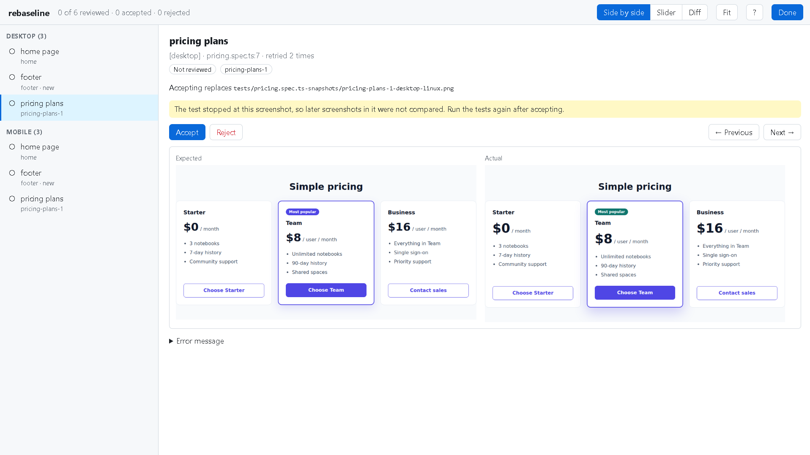
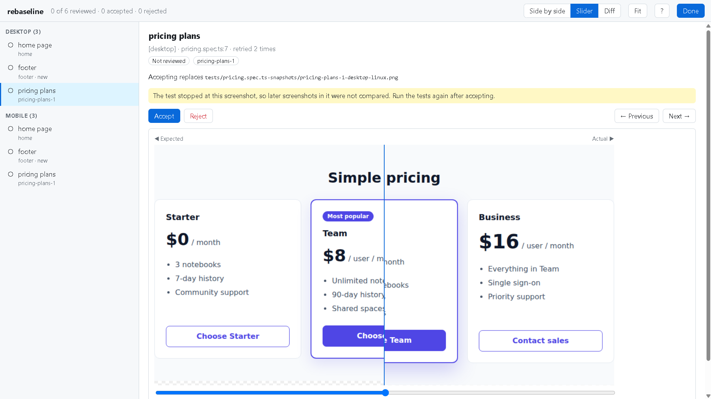
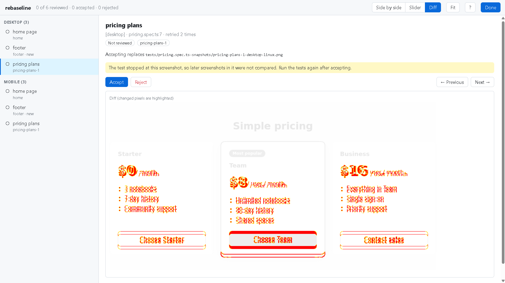

<picture>
  <source media="(prefers-color-scheme: dark)" srcset=".github/assets/logo-dark.svg">
  
</picture>

# rebaseline

**Stop using Docker just to update Playwright snapshots from CI.**

rebaseline shows the failed `toHaveScreenshot` results of a Playwright run in your browser (expected, actual and diff) and writes the screenshots you accept to their baseline files in your repository. It works with the report of your last GitHub Actions run, so you can update `-linux.png` baselines from a Mac or Windows machine.

> **Beta.** Try it with `npx rebaseline@beta`. Feedback is very welcome, especially when something fails: open a [discussion](https://github.com/theghost1980/rebaseline/discussions) or an [issue](https://github.com/theghost1980/rebaseline/issues/new/choose).



## Why

Playwright screenshots depend on the operating system, so most teams keep their baselines from Linux CI. When a screenshot changes on purpose, a Mac or Windows machine cannot produce the Linux image. The usual options are running the tests in Docker, a blind `--update-snapshots` in CI, or downloading the report and copying PNG files by hand.

rebaseline does the last one for you: it downloads the report, finds the baseline file of each failed screenshot and replaces only the ones you accept after looking at them.

## Quick start

Run it in your Playwright project folder, or at the root of the repository.

Review the report of your newest GitHub Actions run (it needs the [GitHub CLI](https://cli.github.com)):

```bash
npx rebaseline@beta pull
```

Review a local run:

```bash
npx playwright test
npx rebaseline@beta review
```

Accept or reject each screenshot on the page, then click **Done**. rebaseline prints a summary with `git status` and a `git add` command for the files it wrote. It never commits: check the changes with git and commit them as usual.

## Requirements

- Node.js 22 or newer.
- A git repository with the baselines committed.
- Playwright 1.40 or newer, with the HTML reporter (the default).
- For `pull`:
  - GitHub Actions, with a workflow that uploads the HTML report as an artifact ([see below](#set-up-your-workflow-for-pull));
  - the GitHub CLI (`gh`), tested with version 2.87, signed in with `gh auth login` or with `GH_TOKEN` set to a token that can read Actions (and pull requests, for `--pr`).

macOS, Windows and Linux are supported.

## Set up your workflow for `pull`

`pull` downloads the HTML report that your workflow uploads. Add this step after the step that runs your tests:

```yaml
      - uses: actions/upload-artifact@v7
        if: ${{ !cancelled() }}
        with:
          name: playwright-report
          path: playwright-report/
          retention-days: 30
```

- **The HTML reporter must run in CI.** If your config uses another reporter there, such as `reporter: process.env.CI ? 'github' : 'html'`, add the HTML one: `reporter: [['html'], ['github']]`.
- **Custom report folder:** if your config sets `outputFolder` for the HTML reporter, use that folder as `path`.
- **Custom artifact name:** keep yours and pass it with `--artifact <name>`. `*` matches any text, as in `--artifact "e2e-report-*"`.
- **Sharded runs:**
  - upload the report of each shard as `playwright-report-1`, `playwright-report-2` and so on, for example with `name: playwright-report-${{ matrix.shardIndex }}`, and `pull` joins them;
  - or merge your blob reports into one HTML report with `npx playwright merge-reports`. If `pull` finds blob reports, it prints the job to add.

## Commands

### `rebaseline review`

Reviews a local Playwright HTML report.

| Option | Meaning |
| --- | --- |
| `--report <dir>` | Report folder (default: `playwright-report`) |
| `--run` | Run the Playwright tests first; options after `--` go to Playwright, as in `review --run -- --project=chromium` |
| `--port <port>` | Port for the review page (default: any free port) |
| `--no-open` | Print the address of the page without opening the browser |

### `rebaseline pull`

Downloads the report of a GitHub Actions run and reviews it. By default it uses the newest finished run of the current branch that uploaded a report; runs of other workflows, such as linting, are skipped.

| Option | Meaning |
| --- | --- |
| `--run <id\|url>` | Use this run |
| `--pr <number\|url>` | Use the newest run of this pull request |
| `--artifact <name>` | Report artifact name; `*` matches any text (default: `playwright-report`) |
| `--repo <owner/name>` | GitHub repository (default: from the git remote) |
| `--port <port>` | Port for the review page (default: any free port) |
| `--no-open` | Print the address of the page without opening the browser |

The download goes to a temporary folder that is removed when the review ends.

## The review page

- Side by side, slider and diff views, at fit or actual size.
- **Accept** writes the image to its baseline file right away. **Reject** puts the previous file back.
- Screenshots that cannot be accepted say why, for example when no baseline matches or when two baselines are equally likely.
- Failures that are not screenshots are listed too, so you see the whole run.

| Slider | Diff |
| --- | --- |
|  |  |

| Key | Action |
| --- | --- |
| `A` / `R` | Accept / reject |
| `←` `→` `↑` `↓` `K` `J` | Previous / next |
| `1` `2` `3` | Side by side / slider / diff |
| `Z` | Fit to the window / actual size |
| `?` | Help |

## How it finds the baseline file

The expected image in a Playwright report is a byte-for-byte copy of the baseline in your repository. rebaseline hashes it and looks for the committed PNG file with the same content, so it works with any `snapshotPathTemplate` without reading your config. When several files match, it uses the project, the screenshot name and then the operating system of the report.

- **New screenshots** go to the path in Playwright's "A snapshot doesn't exist at …" message, with the CI workspace folder removed. If your workflow checks out into a subfolder (`actions/checkout` with `path:`), that folder is removed too.
- **Git LFS:** baselines stored as LFS pointers are matched too. Accepting one writes the image, and git-lfs stores it on commit.

Only baselines under the current folder are used. If the screenshots seem to belong to another folder or repository, rebaseline says which one and how to get there.

## What it changes

- It only writes `.png` files, only inside the repository (never in `.git`), and only when you accept a screenshot.
- Writes are atomic, and rejecting an accepted screenshot puts the previous file back.
- It never deletes files, with one exception: after **Done**, it offers to delete the new screenshots you rejected, if git does not track them. The answer is no unless you say yes.
- The review page is served on `127.0.0.1` only, with a random token in its address.
- It does not send data anywhere. `pull` talks to GitHub only through your `gh`.

## Limitations

- GitHub Actions only.
- PNG screenshots only; other formats, such as WebP, are not supported.
- Reports are downloaded whole, so very large ones take a while. The size is shown first, and Ctrl+C stops the download.
- An artifact with only the `test-results/` folder is not enough: upload `playwright-report/`.
- If your checkout is not at the commit the run tested, rebaseline warns you. Accepted screenshots always go to your checkout.
- To review new screenshots, run the tests without `--update-snapshots=none`, which keeps Playwright from saving them.

## Related Playwright issues

Playwright closed these requests as not planned in May 2026. rebaseline is a separate tool for the same workflow.

- [microsoft/playwright#14883](https://github.com/microsoft/playwright/issues/14883): a CLI tool to review and update snapshot test results interactively
- [microsoft/playwright#24310](https://github.com/microsoft/playwright/issues/24310): an "Accept new snapshot" button in the HTML reporter or UI Mode

## Author

Saturno Mangieri ([@theghost1980](https://github.com/theghost1980)) · [LinkedIn](https://www.linkedin.com/in/saturno-mangieri/)

## License

[MIT](LICENSE)
